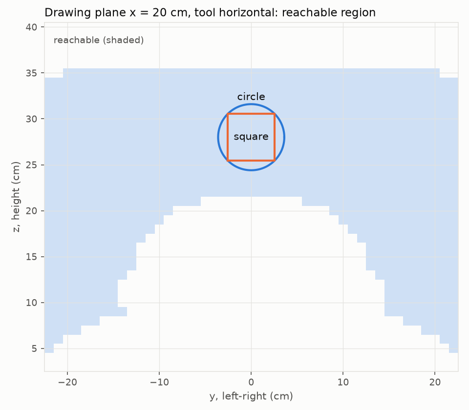

# so101-kinematics

M1 of the [SO-101 series](https://github.com/hujunhan/so101-core). It covers kinematics on the SO-101 arm:

- My 2023 learning library, [arm_control](https://github.com/hujunhan/arm_control), is benchmarked against
  [Pinocchio](https://github.com/stack-of-tasks/pinocchio).
- A joint-limited IK that solves for position **plus an approach angle**.
- The real arm draws shapes, with the tracking error measured.

> **Status (2026-11-06):** S1 and S2 done (simulation only); S3, the real arm, next.

## Plan

| Session | Content | Output |
|---|---|---|
| **S1** | arm_control packaged and fixed (the 2023 version is tagged `v2023`); simulation benchmark. FK accuracy against Pinocchio; position-only IK solvers compared on success rate, time and joint-limit violations | `results/s1_benchmark.md` |
| **S2** | New IK: position + approach angle (gripper pitch, wrist roll), damped least squares with joint limits; drawing in simulation | `src/so101_kinematics/ik.py`, `results/s2_benchmark.md`, `results/s2_drawing.md` |
| **S3** | The real arm draws on a vertical plane ~20 cm in front of the base; commanded vs measured trajectories; tracking error and gravity sag | Video, error plots |
| **S4** | Write-up and decisions/lessons | This README |

## S1 result: the 2023 code on the SO-101 (simulation)

Full table: [results/s1_benchmark.md](results/s1_benchmark.md). There were 200 random reachable targets.
Every solver starts from the zero pose, and success means a position error under 2 mm.

| Solver | Success | ...within joint limits | Median time |
|---|---:|---:|---:|
| arm_control `ik_jacobian`, pseudo-inverse (2023) | 200/200 | **139/200** | 69 ms |
| arm_control `ik_jacobian`, transpose (2023) | 16/200 | 16/200 | 3.7 s |
| arm_control `ik_scipy`, SLSQP with limits (2023) | 192/200 | **192/200** | 621 ms |
| Pinocchio damped least squares (reference, no limits) | 200/200 | **85/200** | **0.2 ms** |

- **FK:** the 2023 code matches Pinocchio to 3.6e-16 m over 1000 configurations. It is correct, not just close.
- **Speed** comes mostly from the implementation, not the algorithm. Pseudo-inverse and DLS are nearly the
  same update. The 2023 code evaluates sympy-generated expressions in Python, and its half-size steps
  (alpha 0.5) need more iterations: about 70 ms per solve, against 0.2 ms for Pinocchio's C++.
- **Joint limits are the real problem.** Unconstrained solvers reach the target with joint angles the arm
  cannot take: 31% of the 2023 pseudo-inverse solutions and 58% of Pinocchio DLS (it takes full Newton
  steps and wanders further). Only the constrained SLSQP respects the limits, at about 3,000× the cost of
  DLS. Sending these solutions to the real arm is what the so101-core safety layer would clip.
- **S2 target:** a solver that respects limits like SLSQP and runs at DLS speed, about 1 ms.

Caveats: the transpose method's step size (0.5) was not tuned. Timings are single-threaded on an
i9-11900H.

## S2 result: joint-limited IK for position + approach angle (simulation)

Full tables: [results/s2_benchmark.md](results/s2_benchmark.md) and [results/s2_drawing.md](results/s2_drawing.md).
Each iteration solves a damped, weighted least squares for the joint step with the joint limits as bounds on
that step (a small active-set loop). Pitch and roll are linear in the joints on this arm
(pitch = -(lift + elbow + wrist_flex), roll = wrist_roll + const, checked against the URDF), so they cost
nothing extra and have no singularity at straight down. 200 random reachable targets, success = under 2 mm
and 0.5 deg:

| Start | ours | naive clamp | SLSQP | Pink (QP) |
|---|---:|---:|---:|---:|
| cold (zero pose) | 159/200, 1.0 ms | 163/200, 0.5 ms | **174/200**, 3.0 ms | 159/200, 0.8 ms |
| far (0.3 rad away) | 198/200, 0.28 ms | 196/200 | 194/200, 2.5 ms | 199/200 |
| warm (0.05 rad, a trajectory step) | **200/200**, 0.08 ms | 200/200 | 199/200, 2.2 ms | 200/200 |

- **Limits are respected by every solver here** (200/200 inside the limits, the clamp baseline too).
  On random in-limit targets the bounded step does **not** clearly beat plain clamping: cold start is even a
  little worse (159 vs 163).
- **Stress test with targets 0.5-5 deg from a limit** ([results/s2_near_limits.md](results/s2_near_limits.md),
  500 targets): the bounded step still does not win. Cold: ours 244, clamp 273, SLSQP 286, Pink 187 of 500
  (only-ours vs only-clamp: 35 vs 64). Far start: 486 vs 481 (13 vs 8, within noise). Warm: 500 vs 500.
  Diagnosis of the 256 cold failures of ours: 174 end at a genuine constrained stationary point, a local
  minimum on the limit boundary. Clamping rarely does (6 of 227); its steps are not descent steps, so it
  sometimes slides out. So the bounded step is a correct local solver, and its remaining failures are a
  seeding problem (where to start), not a stepping problem. The reason clamping escapes more often is my
  reading of those numbers, not something I tested.
- **Speed:** about 1 ms from a cold start and 0.1 ms warm, 3-25x faster than SLSQP. The cold-start median
  was 0.75 ms before the weights below were changed.
- **Cold start is the weak spot** (SLSQP finds 15 more, 42 more near the limits). Drawing uses warm starts,
  where it is 200/200 in both tests.
- **Position first is only soft.** With 5 constraints for 5 joints there is no null space, so the priority
  between position and angles is a weight. At 0.05 per rad an unreachable pitch cost about 17 mm of
  position; 0.01 per rad brings that to 0.8 mm. The weight and the damping must be chosen together (a smaller
  weight with the old damping dropped cold-start success from 173 to 145). The median position error in the
  hard cases where the pitch cannot be reached is 8.6 mm for ours against 0.9 mm for SLSQP, so the
  compromise is not yet as good as it could be.
- **Drawing (simulated):** a circle (radius 3.6 cm) and a square on the plane 20 cm in front of the base,
  tool horizontal (its yaw follows shoulder_pan, so it is not perpendicular to the plane off the centre
  line), 2 mm between points, each point warm-started from the previous one: all points
  converge, position error at most 0.2 mm (the solver tolerance), pitch/roll within 0.1 deg, no joint jumps (largest step 1.4 deg per
  2 mm), 0.12 ms per point. The shapes are sized to keep every joint at least 10 deg from its limit; the
  reachable region at pitch 0 is bounded at the top by shoulder_lift, and the largest circle would come
  within 2 deg of that limit.

## Why "position + approach angle"

The SO-101 has five arm joints, so a full 6-D pose (3 position + 3 orientation) is over-constrained.
shoulder_pan sets the azimuth, so the gripper's yaw is fixed by the target position. The remaining freedom
can hold the gripper's **pitch**, for example pointing straight down for a top-down grasp, and its **roll**
about its own axis. That makes 5 constraints for 5 joints, which is what grasping in M2 and M5 needs.

## Decisions

See [DECISIONS.md](DECISIONS.md).
