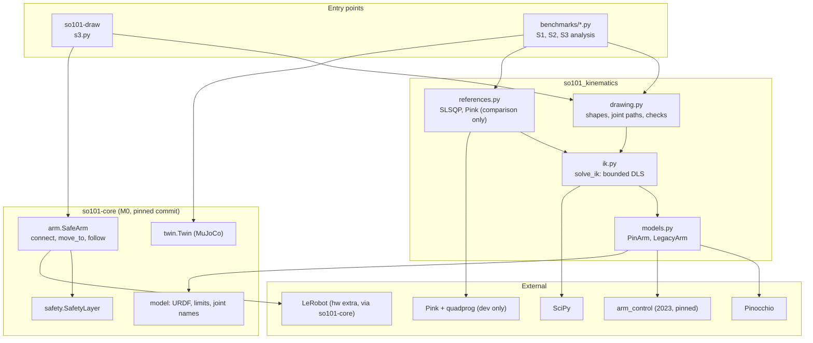
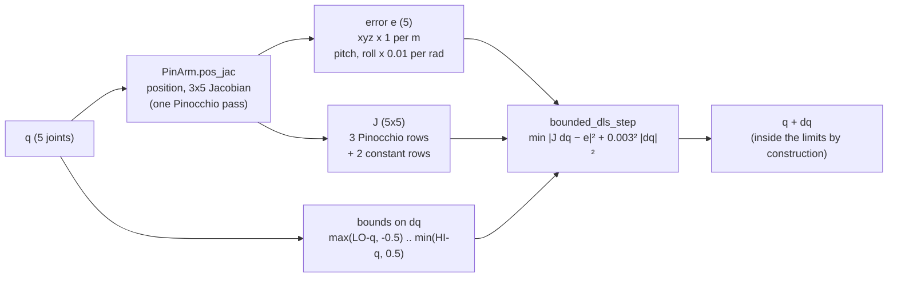
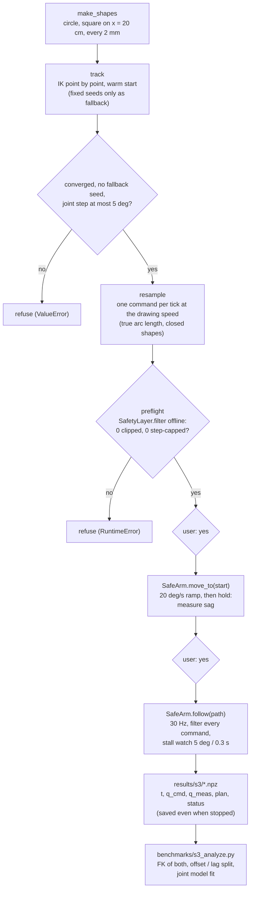
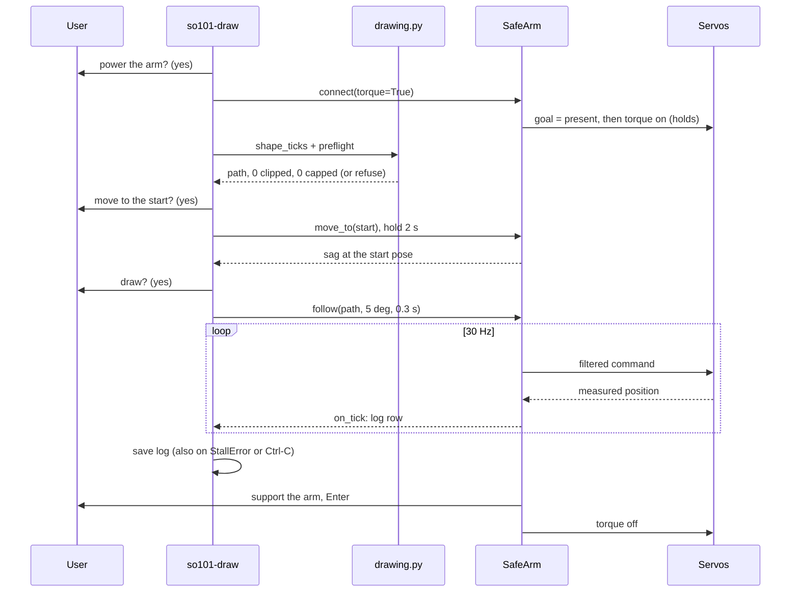

# so101-kinematics design

Why this package looks the way it does, how its parts fit together, and which parts matter most.
State as of 2026-11-06, end of M1. Results are in the [README](../README.md); the decision log, with dates
and the options that were weighed, is [DECISIONS.md](../DECISIONS.md).

## 1. What it is for

M1 of the SO-101 series. It sits on top of [so101-core](https://github.com/hujunhan/so101-core) (M0), which
owns the robot model, units and safe hardware access. M1 adds kinematics and answers three questions:

1. **Was my 2023 library right?** arm_control against Pinocchio on the same URDF (S1).
2. **Can an IK solve position plus an approach angle, inside the joint limits, fast?** (S2)
3. **What happens on the real arm?** Draw shapes and measure how the servos follow (S3).

It deliberately does **not** calibrate the arm or identify the servos (M2), and does not learn anything
(M3). Where M1 found problems in those areas, it recorded them and handed them on (README, "Handed to M2").

## 2. Design goals

| Goal | What it means in the code |
|---|---|
| **Limits are part of the step** | Each IK iteration solves for a joint step with the joint limits as bounds on that step. Nothing relies on clipping afterwards. |
| **Use the arm's structure** | Pitch and roll are linear in the joints on this arm, so they are two constant Jacobian rows, with no singularity at straight down. |
| **One model** | All kinematics run in Pinocchio on the URDF vendored in so101-core. The MuJoCo twin uses the matching MJCF; its tool site agrees with the Pinocchio tool frame to 0.1 mm. |
| **Hardware only through `SafeArm`** | `so101-draw` never writes to the bus. A path is checked before it is sent, then every command passes so101-core's safety filter and stall watch. |
| **Compare on the same task** | Every claim about the solver is made against baselines on identical targets and metrics: naive clamping, scipy BVLS, SLSQP, Pink. |
| **Testable without hardware** | The real-arm stages run end to end in tests against a fake servo bus. This package never imports LeRobot; so101-core loads it only when `SafeArm` connects to a real arm. |
| **Small** | About 670 lines of library code: NumPy, SciPy and Pinocchio. No QP library in the solver. |

## 3. Architecture

### 3.1 Layers



### 3.2 Module dependencies (exact imports)

| Module | Imports from this package | Imports from so101-core | External |
|---|---|---|---|
| `models.py` | none | `model.ARM_JOINTS`, `URDF_PATH`, `urdf_limits` | Pinocchio; arm_control (lazy, inside `LegacyArm`) |
| `ik.py` | `models` | none | NumPy, SciPy (`lsq_linear`, only for `method="bvls"`) |
| `references.py` | `ik`, `models` | `model.ARM_JOINTS` | Pinocchio, SciPy (`minimize`); Pink (lazy, inside `PinkSolver`) |
| `drawing.py` | `ik`, `models` | none (a `SafetyLayer` is passed in) | NumPy |
| `s3.py` | `drawing`, `models` | `arm.SafeArm`, `config.DeviceConfig`, `model.JOINTS` | NumPy |

`ik.py` does not know about the hardware, and `s3.py` does not know how the IK works. `drawing.py` is the
seam between them; the S2 simulation and the S3 real-arm runs use the same functions from it.

## 4. Data flow

### 4.1 One IK iteration (`ik.solve_ik`)



The loop stops when position and both angles are within tolerance (2 mm and 0.5 deg by default; the drawing
uses 0.2 mm and 0.1 deg), after 100 iterations, or when five iterations in a row improve the error by less
than 1 %. The result carries the residuals, the iteration count, and whether a joint sits on a limit, so a
caller can tell "converged", "compromise" and "stuck at a limit" apart.

### 4.2 From a shape to the arm and back



### 4.3 Four layers of protection before and during motion

| Layer | Where | What it catches |
|---|---|---|
| Plan checks | `drawing.shape_ticks` | A non-converged IK point (a wrong target), a fallback seed (possibly another elbow branch), a joint jump between points. The safety layer cannot see any of these. |
| Margin by design | `benchmarks/s2_drawing.py` | Shapes are shrunk until every joint stays at least 10 deg from its limit, twice so101-core's 5 deg margin. |
| Preflight | `drawing.preflight`, called by `s3.draw` | Any command the safety filter would clip or step-cap, i.e. a path that would not be drawn as planned. |
| Runtime (so101-core) | `SafeArm.command`, `follow`, `move_to` | Limit clipping and the 2 deg step cap on every command; a joint that lags its command by more than 5 deg for 0.3 s holds the arm and raises `StallError`. |

Above all four, a person confirms before the arm is powered and before each motion, and is next to it.

## 5. Key pieces

### 5.1 The task space

The SO-101 has five arm joints, so a full 6-D pose is over-constrained; shoulder_pan fixes the yaw. The task
is xyz plus two angles of the tool approach axis (the tool frame's z axis):

- **pitch**: its elevation inside the arm's vertical plane. 0 is horizontal and pointing away from the base;
  straight down is -90 deg.
- **roll**: rotation about that axis, 0 when the tool y axis is perpendicular to the arm's plane.

shoulder_lift, elbow_flex and wrist_flex turn about parallel horizontal axes, so

    pitch = -(q_lift + q_elbow + q_wrist_flex),     roll = q_wrist_roll - 2.789 deg

Both were checked numerically against the URDF geometry (standard deviation 1e-11 rad; the -2.789 deg is a
small tilt of the wrist_roll axis in the URDF) and are tested in `tests/test_ik.py`. They are linear, so their
Jacobian rows are constant and there is no singularity anywhere, in particular not at straight down, where
Euler angles would be singular.

Consequence for drawing: pitch 0 keeps the tool horizontal, but its yaw follows shoulder_pan. Away from the
centre line the tool is not perpendicular to the drawing plane (about 9 deg at the square's corners).

### 5.2 The bounded step (`ik.bounded_dls_step`)

Each iteration solves

    min |J dq - e|^2 + lambda^2 |dq|^2     subject to   lb <= dq <= ub

with five variables:

1. **Fast path:** solve the unconstrained damped least squares. If the step is inside the bounds, done. This
   is the common case away from the limits.
2. **Active set:** otherwise, clamp the joints that left their bounds, fix them there, and re-solve for the
   others so they make up for it. Repeat.
3. **Release (KKT check):** if a fixed joint's gradient says the cost would drop by moving back inside,
   free it and re-solve.

On 300 random bounded problems it reaches a cost no worse than scipy's BVLS (`tests/test_ik.py`). The
difference from naive clamping: clamping computes the step as if every joint could move, then cuts the ones
that cannot; the others do not compensate, so the clipped step no longer points downhill.

### 5.3 `so101-draw draw`



## 6. Design decisions and rejected alternatives

| Decision | Why | Rejected alternative |
|---|---|---|
| Joint limits as bounds on each step | 5 constraints for 5 joints leave no null space to push joints away from limits; the limit has to be inside the step. Pink and mink do the same with a QP | Clip after the step (kept as the baseline); null-space projection (no null space here); SLSQP on the whole problem (3x slower) |
| Kept the bounded step as the default although it does not find more solutions | It never relies on clipping, and when it fails it ends at a constrained stationary point, which can be diagnosed. The benchmarks show plain clamping finds a few more solutions from a cold start; switching the default to clamping would also be defensible | Claiming the bounded step is better (the data does not support it) |
| Hand-written active set, not a QP library | Five variables; same cost as BVLS on random problems, faster, no dependency | `scipy.optimize.lsq_linear` (kept as `method="bvls"` to check it); quadprog / OSQP |
| Pitch and roll as joint sums | Linear, exact on this arm, no singularity at straight down | Euler angles (singular at straight down); rotation-matrix error (6-D, over-constrained) |
| Weighted compromise when the pose is unreachable | Degrades gradually near the edge of the workspace; the caller gets the residuals and decides | Fail at once; strict priority (needs a null space) |
| Angle weight 0.01 per rad with damping 0.003 | 0.05 gave up ~17 mm of position for an unreachable pitch; 0.01 gives ~0.8 mm. The damping had to drop with the weight, or cold-start success fell from 173 to 145 of 200 | Keeping 0.05; smaller weights (fewer reached poses) |
| Stop after 5 iterations without 1 % progress | Failing solves used to crawl to 100 iterations; p95 time 10 ms -> 2.5 ms, same success | A fixed iteration cap only |
| Pinocchio for all kinematics | C++, the reference in S1, and the same model as so101-core | arm_control (correct, but ~70 ms per IK: it is the subject of S1, not a dependency) |
| Pink as the main external reference | Built on Pinocchio, so it uses the same model and Jacobian; its QP is the same idea as the bounded step | placo (what LeRobot uses for SO-101; optional later) |
| Shapes sized by a 10 deg joint margin | At pitch 0 the top of the workspace is set by shoulder_lift; the largest reachable circle came within 2 deg of its limit | Sizing by reachability alone |
| Check the plan before sending it | The safety layer clips and caps; it cannot tell a wrong or non-converged IK solution from a right one | Trusting the preflight alone |
| `SafeArm.follow` added to so101-core, not written here | Every later repo that follows a trajectory needs the same loop; safety logic stays in one place | A loop in M1 (would be copied into M2-M5) |
| Stall watch 5 deg / 0.3 s while drawing | A slow path should not drift 15 deg from its command (`move_to`'s default) before stopping. The measured sag (1.9 deg max) leaves room | Reusing `move_to`'s 15 deg / 0.5 s |
| Measure with the joint encoders (FK of measured joints) | Available on every tick and needs no extra hardware. It shows how the servos follow, not where the tool really is | External measurement (camera, ruler): left to M2 |
| Log every tick through `on_tick`, saved in `finally` | A run stopped by a stall is the one most worth analysing | Saving only the return value of `follow` (lost on an exception) |
| The user runs `so101-draw` in their own terminal | It needs `yes` and Enter answered by someone next to the arm; Claude's shell cannot answer them, and should not | Running hardware stages from Claude's shell |
| Benchmarks as scripts with fixed seeds, results (md + json) committed | Every number in the README can be regenerated and diffed | Notebooks; results only in the README |

## 7. File by file

Importance: **★★★** load-bearing (a bug here sends wrong commands or changes every result), **★★** foundation,
**★** supporting.

### Library (`src/so101_kinematics/`)

| File | Lines | Importance | What it does | Uses | Used by |
|---|---:|:-:|---|---|---|
| `ik.py` | 144 | ★★★ | Task space (pitch, roll, `ROLL_OFFSET`), `bounded_dls_step`, `solve_ik` with methods `activeset` (default), `bvls`, `clamp`; `IKResult` | `models` | `drawing`, `references`, benchmarks, tests |
| `drawing.py` | 132 | ★★★ | Drawing constants (plane, centre, radius), `make_shapes`, `solve_point`, `track`, `ramp`, `resample`, `shape_ticks` (with the plan checks), `preflight` | `ik`, `models` | `s3`, `s2_drawing`, `s2_replay`, tests |
| `s3.py` | 185 | ★★★ | `so101-draw`: `read_only`, `plan_shape`, `go_to_start` (sag), `draw` (follow, log), confirmations | `drawing`, `models`; so101-core `SafeArm` | the user; tests |
| `models.py` | 104 | ★★ | `PinArm` (FK, Jacobian, one-pass `pos_jac`, textbook DLS) and `LegacyArm` (arm_control 2023) on the same URDF; `LO`, `HI`, `N` | so101-core `model`; Pinocchio; arm_control | everything |
| `references.py` | 106 | ★ | `solve_ik_slsqp` and `PinkSolver` (gripper locked out of the model), same weights, for comparison | `ik`, `models`; Pink | benchmarks, tests |

### Benchmarks (`benchmarks/`, scripts)

| File | Session | Writes | What it does |
|---|---|---|---|
| `s1_benchmark.py` | S1 | `results/s1_benchmark.*` | FK agreement over 1000 configurations; position-only IK of arm_control vs Pinocchio |
| `s2_benchmark.py` | S2 | `results/s2_benchmark.*` | Cold / far / warm starts for all solvers; unreachable pitch; angle-weight sweep |
| `s2_near_limits.py` | S2 | `results/s2_near_limits.*` | 500 targets 0.5-5 deg from a limit; paired comparison |
| `s2_drawing.py` | S2 | `results/s2_drawing.*`, `s2_workspace.png`, `s2_joints.png` | Reachable region of the plane, shape sizing by joint margin, simulated drawing |
| `s2_replay.py` | S2/S3 | none | The planned run (ramp, circle, square) in the MuJoCo twin, every tick through the safety filter |
| `s3_analyze.py` | S3 | `results/s3_drawing.*`, `results/s3_*.png` | Per run: offset / shape error / lag / delay; per joint: offset, deadband, delay fit over all runs |

### Tests, results, project files

| File | Importance | What it does |
|---|:-:|---|
| `tests/test_ik.py` (10) | ★★ | Pitch / roll formulas against the URDF geometry; straight down is -90 deg; every method stays inside the limits; reaching a target; the compromise; `pos_jac`; active set vs BVLS on random problems; the reference solvers |
| `tests/test_drawing.py` (10) | ★★ | Constants match the S2 result; planned commands pass the safety filter unchanged at 2 and 5 cm/s with a 10 deg margin; the tool stays on the plane and horizontal; preflight catches a bad path; a bad IK point is refused; shapes are closed and drawn at the requested speed |
| `tests/test_s3.py` (6) | ★★ | `so101-draw` against a fake servo bus: a full draw with its log; nothing moves when the user declines; preflight refusal sends nothing; a blocked joint holds the arm; a stall mid-drawing keeps the log; the read-only stage |
| `tests/test_models.py` (3) | ★★ | arm_control FK = Pinocchio FK; Pinocchio Jacobian = finite differences; the textbook DLS reaches a target |
| `results/s3/*.npz` | ★★ | Raw logs of the four real-arm runs (evidence; the analysis reads them) |
| `pyproject.toml`, `uv.lock` | ★★ | Python 3.12; so101-core and arm_control pinned by commit; `hw` extra (LeRobot via so101-core); `so101-draw` entry point; Pink and quadprog as dev dependencies |
| `README.md`, `DECISIONS.md`, `docs/DESIGN.md`, `CLAUDE.md` | ★ | Write-up and results; decision log; this document; working notes for the next session |

### If you read only three files

1. **`ik.py`**: the task space and the bounded step (144 lines).
2. **`drawing.py`**: how a shape becomes joint commands, and what is checked before they are sent.
3. **`s3.py`**: how those commands reach the real arm, and only through `SafeArm`.

## 8. How later repos use it

```python
import numpy as np
from so101_kinematics.ik import solve_ik
from so101_kinematics.models import PinArm

arm = PinArm()
q_current = np.zeros(6)  # in practice: SafeArm.read()
# top-down: gripper straight down (pitch -90 deg), roll 0 (tool y axis perpendicular to the arm's plane)
res = solve_ik(arm, target_xyz=[0.25, 0.05, 0.05], pitch=-np.pi / 2, roll=0.0, q0=q_current[:5])
if not res.converged:  # a compromise: look at the residuals before using it
    print(res.pos_err, np.degrees(res.pitch_err), res.at_limit)
```

For a trajectory, warm-start each point from the previous solution (as `drawing.track` does), check the
result (as `drawing.shape_ticks` does), then send it with so101-core's `SafeArm.move_to` and `follow`.

## 9. Known limits and open items

- **Cold-start IK finds fewer solutions than SLSQP** (159 vs 174 of 200; 244 vs 286 of 500 next to the
  limits), and fewer than plain clamping. Most failures are local minima on a limit, so the fix is a better
  seed (roll and the pitch sum are known exactly; the rest is a planar two-link problem). Not done.
- **The compromise for an unreachable pitch** has a median position error of 8.6 mm, against 0.9 mm for SLSQP.
- **The model does not match the arm**: 10 cm on the table is 8.66 cm by FK. Probably a calibration zero
  offset on the elbow or wrist; two points cannot say which. M2.
- **Servo delay (~100 ms) and elbow sag (0.9 deg) are measured, not compensated.** A feed-forward run is the
  direct test of the joint model. M2.
- **S3 errors are encoder-based.** They show how the servos follow the commands, not where the tool is.
- **The yaw is not controlled** (5 joints): a drawn shape is not seen head-on except on the centre line.
- **Python speed.** About 1 ms per cold solve and 0.1 ms warm, mostly NumPy overhead on 5x5 problems; fine
  for 30 Hz, not tuned further.
- **No CI** in this repo (so101-core has one). `uv run ruff check . && uv run pytest` is run by hand before
  each commit; the tests need arm_control and Pinocchio but no hardware and no LeRobot.
