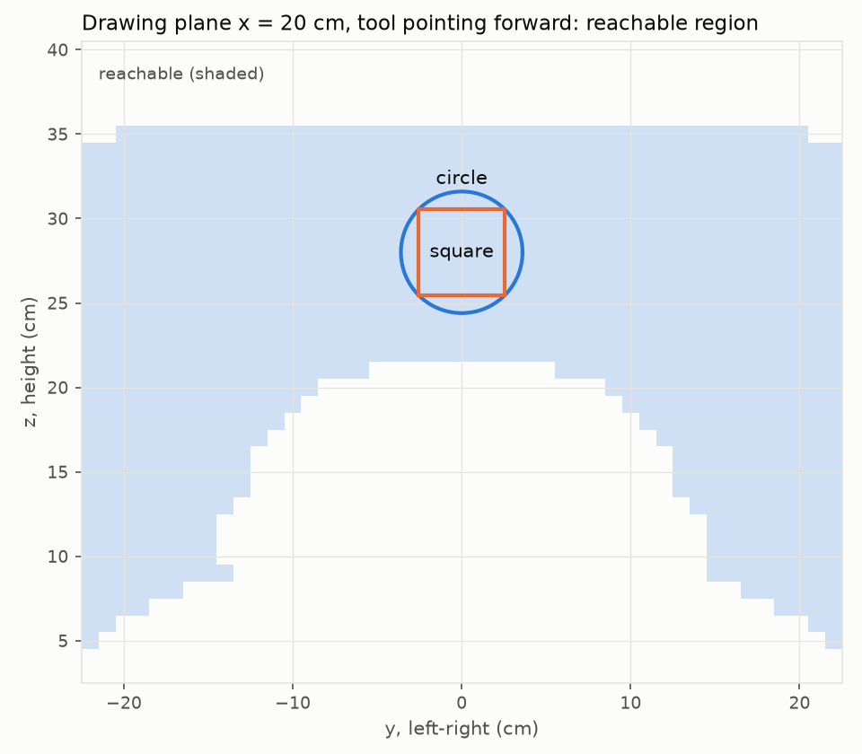
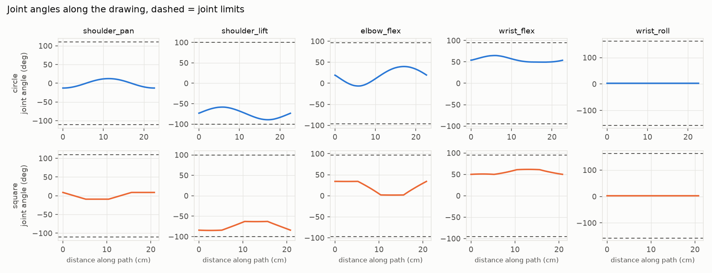

# S2 drawing in simulation

Plane x = 20 cm in front of the base-frame origin, tool pointing forward (pitch 0, roll 0). Reachable: 929/1710 cells of 1 cm (lower bound, a few seeds). Circle: center y = 0.0 cm, z = 28.0 cm, radius 3.6 cm (the largest reachable circle has radius 7.0 cm, shrunk until every joint stays 10 deg from its limit); the square sits inside that circle. Points every 2 mm, warm-started from the previous point. Joint speeds assume 5 cm/s.

| Solver | Shape | Points | Not converged | Max pos. err | Max pitch / roll err | Max joint step | Max joint speed | Closest to a limit | Median / max solve |
|---|---|---:|---:|---:|---:|---:|---:|---:|---:|
| ours (active set) | circle | 114 | 0 | 0.01 mm | 0.10 / 0.00 deg | 1.39 deg | 35 deg/s | 10.7 deg | 0.12 / 0.8 ms |
| ours (active set) | square | 105 | 0 | 0.01 mm | 0.10 / 0.00 deg | 1.44 deg | 37 deg/s | 15.1 deg | 0.12 / 0.7 ms |
| clamp baseline | circle | 114 | 0 | 0.01 mm | 0.10 / 0.00 deg | 1.39 deg | 35 deg/s | 10.7 deg | 0.11 / 0.4 ms |
| clamp baseline | square | 105 | 0 | 0.01 mm | 0.10 / 0.00 deg | 1.44 deg | 37 deg/s | 15.1 deg | 0.11 / 0.4 ms |
