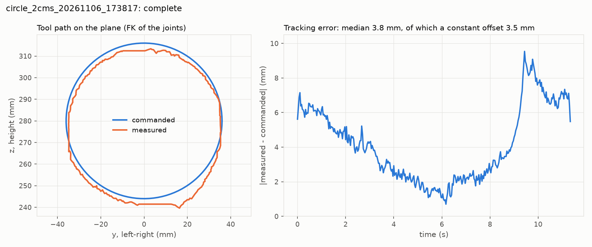
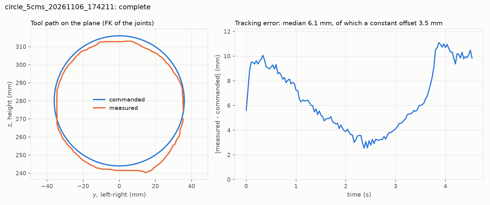
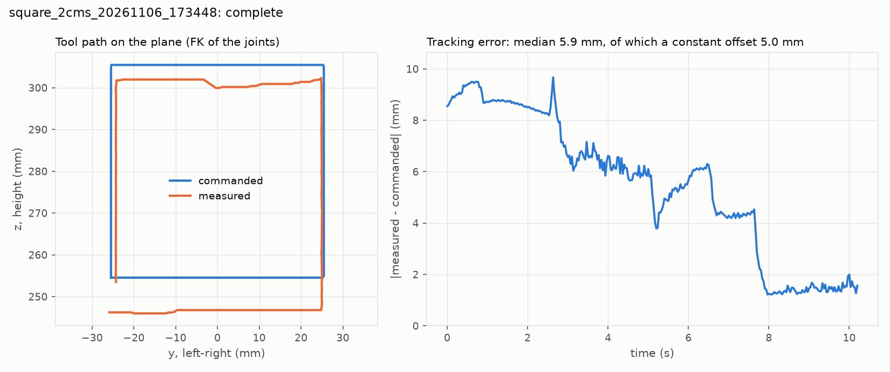
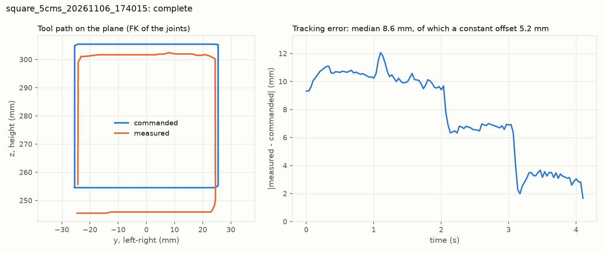

# S3: drawing on the real arm

Tool positions are the FK of the commanded and the measured joints (servo encoders), so these numbers are about how the servos follow the commands, not about the absolute accuracy of the model. Offset = mean of measured - commanded (x is out of the plane, z is up). Shape error = what is left after removing the offset. Along = mean of the remaining error along the direction of motion (negative: behind the command). Delay = the time shift that best lines up the two paths.

| Run | Status | Duration | Error median / max | Offset x, y, z | Shape error median / max | Along | Delay | Size cmd -> meas (y x z) |
|---|---|---:|---:|---:|---:|---:|---:|---:|
| circle_2cms_20261106_173817 | complete | 11.3 s | 3.8 / 9.5 mm | +0.2, +0.2, -3.5 mm | 2.8 / 6.2 mm | -2.8 mm | 133 ms | 7.20 x 7.20 -> 7.03 x 7.37 cm |
| circle_5cms_20261106_174211 | complete | 4.5 s | 6.1 / 11.1 mm | +0.2, +0.3, -3.4 mm | 6.1 / 8.2 mm | -6.0 mm | 133 ms | 7.20 x 7.20 -> 7.00 x 7.28 cm |
| square_2cms_20261106_173448 | complete | 10.2 s | 5.9 / 9.7 mm | +1.1, +0.3, -4.9 mm | 3.6 / 5.1 mm | -2.6 mm | 133 ms | 5.09 x 5.09 -> 5.09 x 5.63 cm |
| square_5cms_20261106_174015 | complete | 4.1 s | 8.6 / 12.1 mm | +1.0, +0.2, -5.1 mm | 6.0 / 8.7 mm | -5.6 mm | 100 ms | 5.09 x 5.09 -> 4.91 x 5.69 cm |

Largest following error per joint (deg) and the sag measured at the start pose (deg):

| Run | shoulder_pan | shoulder_lift | elbow_flex | wrist_flex | wrist_roll |
|---|---:|---:|---:|---:|---:|
| circle_2cms_20261106_173817 | 1.08 (sag -0.33) | 1.61 (sag +0.56) | 2.88 (sag -1.73) | 1.36 (sag +0.17) | 0.42 (sag +0.42) |
| circle_5cms_20261106_174211 | 2.03 (sag -0.33) | 2.91 (sag +0.56) | 4.78 (sag -1.73) | 2.02 (sag +0.17) | 0.42 (sag +0.38) |
| square_2cms_20261106_173448 | 0.98 (sag -0.04) | 1.66 (sag +0.43) | 2.88 (sag -1.87) | 1.40 (sag -0.49) | 0.42 (sag +0.33) |
| square_5cms_20261106_174015 | 2.07 (sag +0.40) | 3.08 (sag +0.43) | 5.19 (sag -1.87) | 1.96 (sag -0.76) | 0.33 (sag +0.33) |

Joint model fitted over all 4 runs (moving ticks): error = offset - sign(v) * (deadband + delay * |v|). The delay includes about one tick (33 ms) from reading right after each command.

| Joint | Offset (sag) | Deadband | Delay | R2 |
|---|---:|---:|---:|---:|
| shoulder_pan | -0.05 deg | 0.13 deg | 97 ms | 0.95 |
| shoulder_lift | -0.44 deg | 0.12 deg | 107 ms | 0.93 |
| elbow_flex | +0.89 deg | 0.39 deg | 109 ms | 0.95 |
| wrist_flex | +0.33 deg | 0.17 deg | 113 ms | 0.87 |

